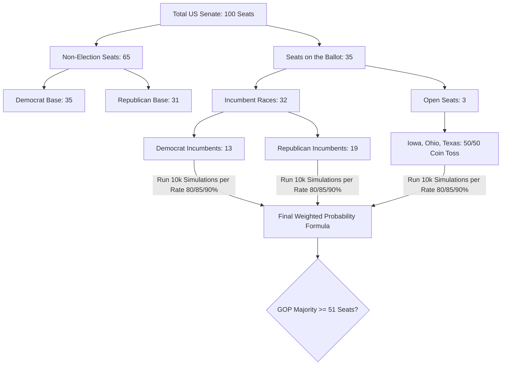

# 2026 US Senate Election Simulation Model

This repository contains a lightweight, programmatic mathematical model built using Python to analyze and predict the final distribution of seats in the US Senate for the November 2026 midterm elections. 

## Model Overview

Unlike traditional media models that purely aggregate statewide polling averages, this model leverages a conditional **Monte Carlo simulation framework** combined with **Bayesian-style subjective weights** applied across three distinct scenarios of incumbent protection capacity.

### Model Architecture



А сохраненный график `senate_simulation_chart.png` можно положить в папку `img` вашего репозитория и подключить стандартной строкой:
```markdown

```

<FollowUp>
Если вы хотите, я могу:
* **Интегрировать код генерации графика** прямо в основной файл `senate_simulation.py`, чтобы он считал цифры и сразу выдавал картинку пользователю при запуске.
* Помочь составить **Git-команды** для быстрой заливки всего этого проекта на ваш GitHub.

Что будет удобнее сделать?
</FollowUp>
 
### Structural Parameters (November 2026 Baseline)
*   **Total Senate Seats:** 100
*   **Non-Election Baseline (Safe Hold):** Democrats hold **35** seats, Republicans hold **31** seats.
*   **Defending Incumbents:** 32 seats total (**19** held by Republicans, **13** by Democrats).
*   **Pure Open Toss-ups:** **3** seats with no incumbent advantage (Iowa, Ohio, Texas).

---

## Scenarios & Probability Distribution

The model runs 10,000 simulations per configuration across three core operating rates, reflecting different systemic polling errors and turnout dynamics:

1.  **80% Protection Rate (Weight: 25%):** "Blue Wave" dynamic where anti-administration headwinds or systematic undercounting of suburban voters lower standard incumbent defenses.
2.  **85% Protection Rate (Weight: 55%):** The current consensus model where strong regional candidates decouple from national polarization trends.
3.  **90% Protection Rate (Weight: 20%):** Standard historical benchmark where structural institutional advantages (fundraising, name recognition) override political polarization.

---

## How it Works

The probabilistic logic utilizes the **Binomial Distribution** to calculate independent trials for incumbent protection and open seat distribution. The macro-level outcome is then processed using the Law of Total Probability:

$$P(\text{GOP Majority}) = \sum_{i} P(\text{GOP Majority} \mid \text{Scenario}_i) \times P(\text{Scenario}_i)$$

## Requirements and Execution

The simulation requires standard `numpy`. To execute the model file:

```bash
python senate_simulation.py
```

## Results Summary
*   **Weighted GOP Retention Probability:** **52.72%**
*   **Market Context:** The model identifies a notable variance against prediction platforms (e.g., Polymarket/Kalshi at ~75% Democratic favorability), demonstrating that structural incumbent baselines keep the true constitutional outcome hovering near an even toss-up.
